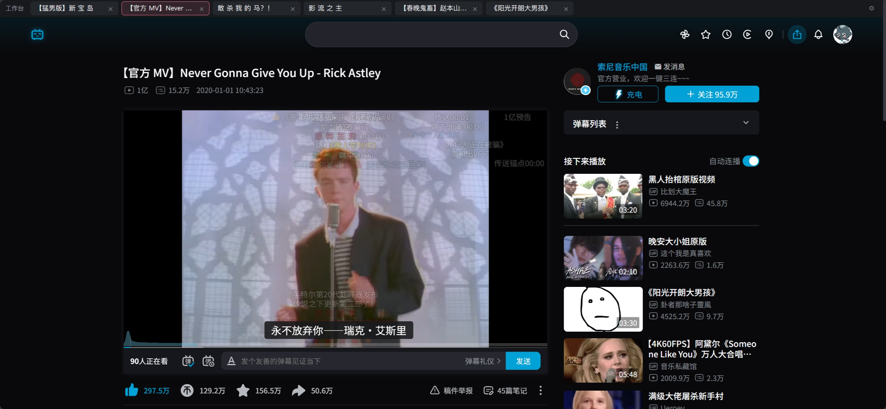
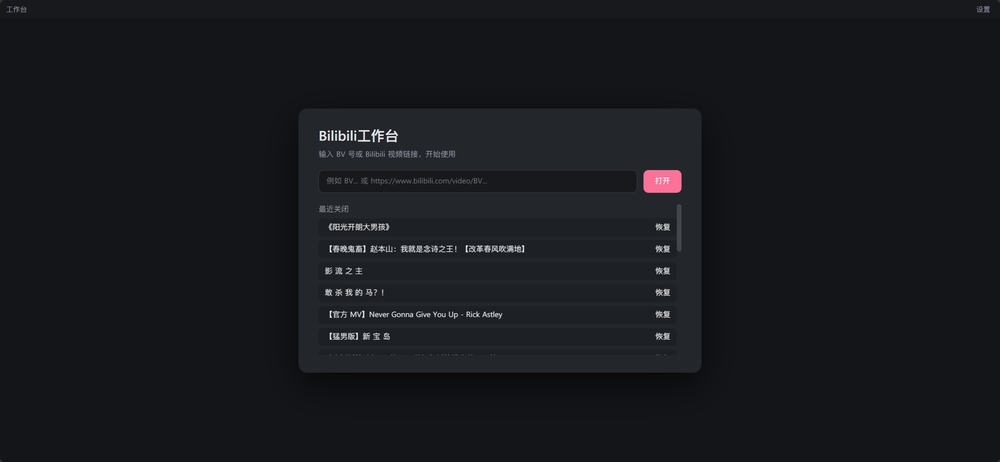
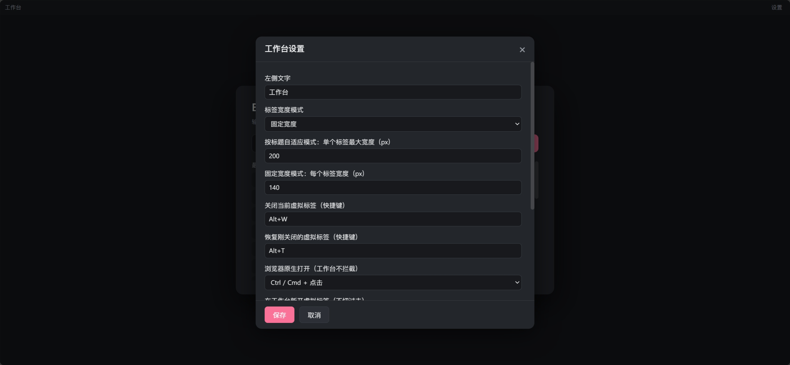

# B站工作台（Bilibili_Videospace）

> 把多个 B站 视频标签页合并进**一个真实的 B站 页面**：切换时只换视频/评论/推荐，不刷新页面。
> 除了页面顶部多一条标签栏，其余界面和功能完全还是 B站 自己的。
> 同时开启大量视频页时大幅度节省内存。

[](https://github.com/wsz040826-sys/Bilibili_Videospace)
[](LICENSE)
[](https://developer.chrome.com/docs/extensions/develop/migrate)
[](https://github.com/wsz040826-sys/Bilibili_Videospace#安装)



## 这是什么

浏览器里同时开启大量 B站 视频标签页，内存很容易被吃掉——每个标签页都是一份完整的 B站 页面（播放器、弹幕、评论区、推荐、各种 JS 状态）。

**B站工作台**只保留**一个**真实的 B站 视频页面作为"宿主"，把其它 B站 视频收进这个页面顶部的标签栏里。切换标签时：

- 不打开新页面、不整页刷新；
- 播放器、评论、推荐、弹幕等全部原地更新；
- B站 原有功能（点赞、投币、收藏、发弹幕、选集、字幕……）和各类扩展全部可用。

## 功能

- 🗂 **虚拟标签栏**：顶部一条标签栏管理多个 B站 视频，点标签切换、点 × 关闭，标签过多自动压缩。
- 🔁 **无刷新切换**：复用 B站 页面自己的站内切换逻辑（`RELOAD_VIDEO`），只换内容，不刷新页面。
- 🧲 **自动归并**：打开新的 B站 视频标签页时自动收进工作台（可设置"保持第一个"或"切到最新一个"）。
- ⌨️ **快捷键**：`Alt+W` 关闭当前虚拟标签，`Alt+T` 恢复刚关闭的标签（均可自定义）。
- 🖱 **修饰键**：
  - `Ctrl/Cmd + 点击` 视频链接 = 浏览器原生新标签页，工作台不拦截；
  - `Shift + 点击` 视频链接 = 在工作台新开一个虚拟标签（不切过去）。
- 📄 **空白工作台**：关掉所有虚拟标签后，宿主导航到一个不加载 B站 的空白页；可输入 BV 号/链接，或从"最近关闭"恢复。
- 🎨 **可配置**：标签栏文字、标签宽度模式、点击修饰键、快捷键、网页全屏时隐藏标签栏、debug 日志等。
- 🧩 **兼容 B站 生态**：页面是真的 B站 页面，所以 B站 自身的所有界面/交互，以及各种 B站 相关扩展（如 BewlyBewly）都不受影响。



## 性能数据

> 测试环境：作者机器 Windows 11、Microsoft Edge 157.0.4341.42、B站 网页版；测试时同时启用了 BewlyBewly 扩展；采用浏览器整个进程的内存数据。

| 场景 | 内存占用 |
|---|---|
| 单 Edge + blank初始页 | 723 MB |
| 5 个 B站 视频标签页（未启用本扩展） | **3044 MB** |
| 1 个 B站 宿主页 + 5 个虚拟标签（启用本扩展） | **1580 MB** |
| 节省 | **≈ 1464 MB（约 48%）** |

- 启用本扩展后，无论工作台里放多少个虚拟标签，**内存里始终只有一个 B站 页面实例**。

| 指标 | 实测 |
|---|---|
| 新标签页从开始加载 → 被扩展拦截并归并 | **约 0.3–0.5 秒**（页面尚未加载完就被关闭） |
| 工作台内切换虚拟标签（点击 → 新视频内容生效） | **约 1–3 秒**（取决于网络与 B站 数据接口；全程不完整刷新页面） |
| 体积 | 约 **108 KB**（不含README所用截图） |
| 代码量 | 约 **1700 行** JS |

## 工作原理

```
┌───────────────────────────────────────────────┐
│ 工作台标签栏（扩展注入的 Shadow DOM，30px）    │
├───────────────────────────────────────────────┤
│                                               │
│   真实的 B站 视频页面（宿主）                   │
│   ├─ 播放器 / 弹幕 / 评论 / 推荐 / 点赞投币收藏 │
│   └─ 全部是 B站 自己的 UI 和逻辑                │
│                                               │
└───────────────────────────────────────────────┘
```

1. **宿主**是一个真实的 `bilibili.com/video/*` 页面。扩展只在页面顶部注入一条标签栏，并把页面整体下移，不替换、不重画 B站 的界面。
2. 其它 B站 视频标签页一出现，扩展会在**页面开始导航前**（`webNavigation.onBeforeNavigate`）就拦截：记录 BV 号、通过 B站 接口取标题、关闭新标签，然后让宿主切过去。
3. 切换虚拟标签时，扩展在页面主世界（MAIN world）里调用 B站 视频页自己的 `VideoPageCard.pathTo()`，触发站内 `RELOAD_VIDEO` 事件——B站 会以自己的 SPA 方式更新播放器/评论/推荐，**页面实例保持不变**。
4. 找不到推荐卡组件等极端情况下，才退化为整页导航（此时会刷新页面）。

## 安装

### Edge

1. `git clone https://github.com/wsz040826-sys/Bilibili_Videospace`（或 Download ZIP 并解压）；
2. 打开 `edge://extensions`，开启左下角「开发人员模式」；
3. 点击「加载解压缩的扩展」，选择仓库根目录（包含 `manifest.json` 的那一层）；
4. 打开任意 B站 视频页即可。

> Chromium 内核浏览器（Chrome 等）理论上同理：`chrome://extensions` → 开发者模式 → 加载已解压的扩展程序。目前主要在 Edge 上测试。

## 使用

- 打开第一个 B站 视频后，它会自动成为工作台宿主；
- 之后再打开 B站 视频标签页，会自动收进顶部标签栏；
- 点标签切换视频，点 × 或 `Alt+W` 关闭，`Alt+T` 恢复；
- 页面内点击推荐视频默认替换当前虚拟标签；按住 `Shift` 点击则新开虚拟标签；按住 `Ctrl/Cmd` 点击则交给浏览器原生新标签页；
- 点扩展图标可聚焦工作台；没有标签页时会打开空白工作台。

## 设置

点标签栏右侧的 ⚙（页内居中弹窗，跟随页面深浅色）：

| 设置项 | 说明 |
|---|---|
| 左侧文字 | 标签栏最左侧的文字，可留空隐藏 |
| 标签宽度模式 | 按标题自适应（含最大宽度）/ 固定宽度 |
| 关闭 / 恢复快捷键 | 默认 `Alt+W` / `Alt+T`，可自定义 |
| 浏览器原生打开 | 默认 `Ctrl/Cmd + 点击` |
| 工作台新开虚拟标签 | 默认 `Shift + 点击` |
| 同时收进多个视频时 | 保持第一个打开的 / 切换到最后一个打开的 |
| 关闭全部虚拟标签后 | 显示空工作台 / 关闭本标签页 |
| 下次启动自动恢复标签页 | 开 / 关 |
| 网页全屏时隐藏标签栏 | 开 / 关 |
| debug 模式 | 开启后标签栏出现「日志」，可查看诊断信息和日志 |



## 常见问题

**Q：为什么按 `Ctrl+W` 会把整个工作台关掉？**
`Ctrl+W` 是 Chromium 的保留快捷键，扩展和网页都无法拦截。工作台里请用标签上的 × 或 `Alt+W` 关闭单个虚拟标签。

**Q：会不会影响 B站 原有功能或其它 B站 扩展？**
不会。工作台只是在一个真实的 B站 页面顶部加了一条标签栏，B站 的 DOM/JS 没有被替换，所以各 B站 扩展照常工作。

**Q：切换标签需要重新加载视频吗？**
不需要。切换走的是 B站 自己的站内切换（SPA），播放器、评论、推荐原地更新。只有首次打开/兜底场景才会整页加载。

**Q：为什么标签栏会下移 B站 顶部导航？**
B站 的顶部导航是固定定位的，扩展会检测这些元素并整体下移，避免被标签栏遮住。

## 已知限制

- **无法拦截 `Ctrl+W`**：Chromium 保留快捷键，只能使用 × / `Alt+W`。
- **依赖 B站 前端内部结构**：站内切换依赖 `VideoPageCard.pathTo()` / `RELOAD_VIDEO`，B站 若大改版可能失效（失效时退化为整页导航）；扩展会尽量通过 Vue 组件树兜底查找。
- **无法真正隐藏标签页**：扩展 API 不允许把标签页从标签栏隐藏，所以"关闭工作台但后台保留"这类功能无法干净实现，未提供。
- 只处理 `www.bilibili.com/video/*` 视频页；动态、历史、收藏、主页、直播等页面不受影响。
- 首次启用时，同一窗口中已有的其它 B站 视频标签页可能被合并（可在设置里调整后续行为）。

## 目录结构

```
manifest.json          MV3 配置
background.js          工作台状态、标签归并/拦截、宿主管理
content.js             顶部标签栏 UI（Shadow DOM）、快捷键、设置弹窗、布局偏移
main-world.js          注入 B站 页面主世界，调用站内切换
blank.html / blank.js  空白工作台页面（不加载 B站 视频页）
options.html/js        独立设置页（备用）
debug.html / debug.js  debug 日志与诊断查看
assets/                icon 和 README 截图
```

## 更新记录

- **1.0.0**：首个正式版本。固定 30px 标签栏、标签栏文字可为空、debug 关闭时隐藏日志按钮、默认设置对齐日常使用。
- **0.4.x**：标签栏高度统一、空白工作台页、设置弹窗统一、诊断并入日志、修复黑边/标题错位/焦点抢夺等。
- **0.3.x**：改用真实 B站 页面 + 顶部标签栏，复用站内 SPA 切换。
- **0.1 / 0.2**：早期原型（自建播放器框架、原生标签休眠方案）。

## 免责声明

本项目是非官方第三方扩展，与哔哩哔哩（bilibili）官方无任何关联；不修改视频内容、不绕过会员/版权限制，仅用于个人学习与效率提升。使用本扩展产生的任何后果由使用者自行承担，请遵守 B站 用户协议及相关法律法规。

## License

[MIT](LICENSE)

---

如果这个项目对你有帮助，欢迎 Star ⭐
